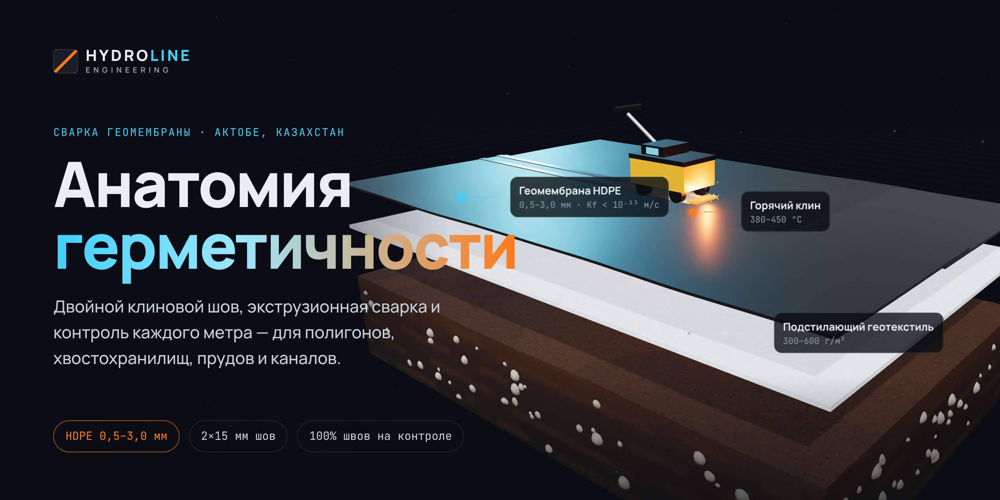

# Hydroline — сайт услуг по сварке геомембраны

Одностраничный сайт с 3D-анимацией в стиле «анатомического атласа» на Three.js.
Прокрутка управляет сценой:

1. **Hero** — фрагмент противофильтрационного экрана на «витрине».
2. **Анатомия** — слои разъезжаются с подписями: основание, геотекстиль, геомембрана HDPE, шов, защитный слой.
3. **Сварка** — клиновой автомат проходит по нахлёсту, оставляя двойной шов (искры, нагрев).
4. **Контроль** — испытание воздушного канала давлением, анимированный манометр.
5. **Объекты, услуги, этапы, заявка.**

## Запуск

Сборка не нужна — статические файлы, Three.js грузится с jsDelivr.

```bash
python3 -m http.server 8080   # затем http://localhost:8080
```

## Деплой на Vercel

1. [vercel.com/new](https://vercel.com/new) → Import Git Repository → выберите `hydroline`.
2. Настройки оставьте по умолчанию — `vercel.json` сам задаёт сборку (`node build.mjs` → папка `dist/`).
3. Deploy.

`build.mjs` подставляет реальный адрес сайта в мета-теги превью (`og:image` должен быть
абсолютной ссылкой). Свой домен можно задать переменной окружения `SITE_URL=https://ваш-домен` (по умолчанию — hydroline-zeta.vercel.app)
в Settings → Environment Variables. Проверить превью: [opengraph.xyz](https://www.opengraph.xyz).
Telegram кэширует превью — после исправления обновите его через бота @WebpageBot.

## Баннер и иконки

| Файл | Размер | Для чего |
|---|---|---|
| `og-image.png` | 1200×630 | превью ссылки в Telegram, WhatsApp, соцсетях, Vercel |
| `docs/banner.png` | 2560×1280 | баннер README / GitHub Social preview (Settings → General) |
| `favicon.svg`, `favicon-32.png` | — | иконка вкладки |
| `apple-touch-icon.png`, `icon-192/512.png` | — | иконка на телефоне, `site.webmanifest` |

Баннер рендерится из настоящей 3D-сцены: `banner.html` — та же модель в фиксированном
состоянии (`window.HYDRO_POSTER`). Чтобы перегенерировать: откройте `/banner` в окне 1200×630 и сделайте скриншот.

## Что поменять под себя

- `index.html` — тексты, телефон и почта (сейчас заглушки), список услуг.
- `main.js` → массив `K` — положения камеры и состояния сцены для каждой секции; `labelDefs` — 3D-подписи.
- Форма заявки сейчас только показывает сообщение — подключите обработчик (Telegram-бот, CRM, почта) в конце `main.js`.
